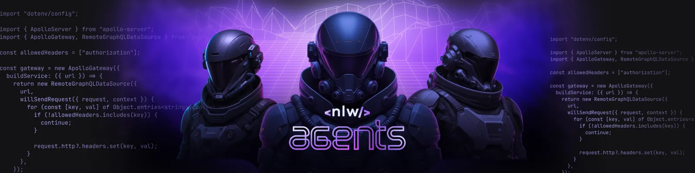

<h1 align="center"> NLW Agents - Assistente de Meta 🎮</h1>

Assistente de IA para gamers que responde dúvidas de estratégia com a API do Gemini

  <a href="#-tecnologias">Tecnologias</a>&nbsp;&nbsp;&nbsp;|&nbsp;&nbsp;&nbsp;
  <a href="#-projeto">Projeto</a>

  
 

## 🚀 Tecnologias

Esse projeto foi desenvolvido com as seguintes tecnologias:

- HTML
- CSS
- JavaScript
- Gemini API
- Showdown (Markdown para HTML)
- Git e Github

## 💻 Projeto

- O Assistente de Meta foi desenvolvido no NLW Agents da Rocketseat, revisitando o clássico NLW eSports com IA: o jogador escolhe o jogo (League of Legends, Valorant ou CS:GO), escreve a pergunta e recebe dicas de estratégia, builds e meta atual geradas pela IA.

- A aplicação é feita com HTML, CSS e JavaScript puro, chamando a API do Gemini (modelo gemini-2.5-flash) direto do navegador com `fetch`. A chave da API é digitada pelo próprio usuário na interface, então nenhuma credencial fica no código.

<h2 align="center">📌 Desenvolvedores</h2>

<table align="center">
  <tr>
    <td align="center">
      <a href="https://github.com/rebellatoGui" title="GitHub">
         
        
          <b>Guilherme Rebellato</b>
        
      </a>
    </td>
  </tr>
</table>

 

---

Feito com ♥ por rebellatoGui

